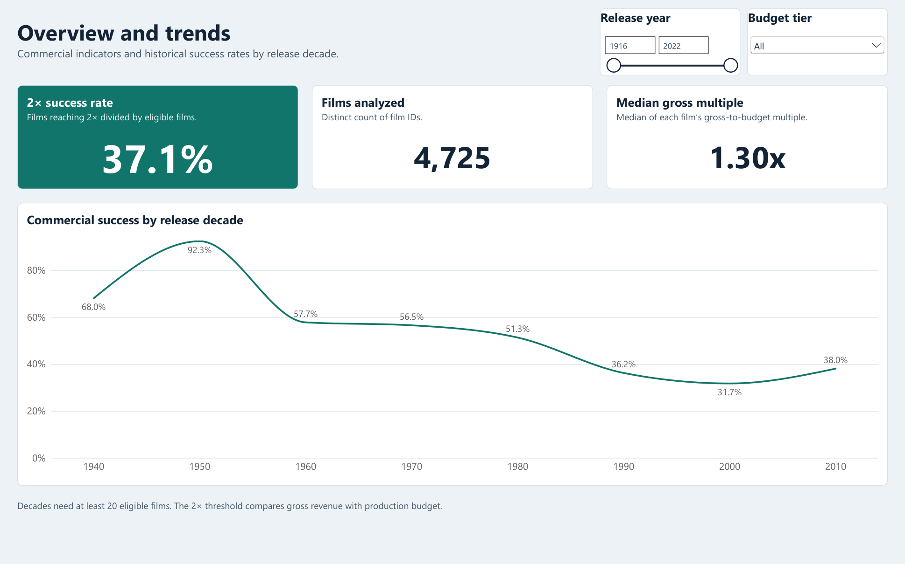

# CineScope — Movie Analytics Lakehouse

CineScope turns historical film data into a decision tool for production companies. It compares performance by **genre, production budget, production company, and release period** to help teams shortlist projects, set budget ceilings, and identify potential co-production partners.

The project follows the full data path from date-batched CSV and JSON files in **Azure Data Lake Storage Gen2** to a **Power BI** dashboard. The lakehouse uses **Azure Databricks, PySpark, SQL, Delta Lake, and Unity Catalog**. Power BI uses **Power Query and DAX**, with editable project definitions versioned alongside the notebooks in **Git and GitHub**.

[Dashboard](#power-bi-dashboard) · [Architecture](#architecture) · [Setup](#configuration-and-execution)

## Results at a glance

| Measure | Validated snapshot |
| --- | ---: |
| Films analyzed | **4,725** |
| Valid film–genre associations | **11,935** |
| Valid film–production-company associations | **13,468** |
| Eligible films grossing at least 2× their production budget | **37.1%** |
| Median gross-to-budget multiple | **1.30×** |
| Gold bridges passing duplicate and orphan checks | **2 of 2** |

Dashboard metrics reflect the unfiltered snapshot. The 2× rate considers films with positive budget and gross revenue. Estimating producer profit also requires distribution splits, marketing, and other costs.

## Architecture

Solid arrows show batch data flow and dotted arrows show validation checks. Editable source: [draw.io file](docs/architecture/cinescope-architecture.drawio) · [PNG export](docs/architecture/cinescope-architecture.png)

Each run processes one `file_date` batch. The layers update incrementally, so earlier batches stay in place.

| Layer | Update pattern |
| --- | --- |
| Bronze | `replaceWhere` replaces only the `file_date` slice being loaded |
| Silver | Delta `MERGE` inserts new records and updates existing ones |
| Gold warehouse | Delta `MERGE` on the fact table, the film and production company dimensions, and both bridges. Genre and time dimensions are rebuilt |
| SQL data marts | Views over Gold, with no physical load |
| Power BI | Refresh reloads the imported model |

- **Bronze** — Twelve loaders read the batch selected by the `file_date` widget. They write external Delta tables with the batch date and use `replaceWhere` to replace that slice on reruns.
- **Silver** — PySpark casts and standardizes fields and adds ingestion metadata. Delta `MERGE` uses entity or association keys to update existing records and insert new ones.
- **Gold** — The warehouse builds `fact_movies` at film grain, four dimensions (film, time, genre, and production company), and two bridges (film–genre and film–production company). The annual `dim_time` supplies the release decade.

Three independent SQL views expose the warehouse at the grain each analysis needs.

| View | Grain | Analysis |
| --- | --- | --- |
| `mart_movie_performance` | One row per film | Portfolio KPIs, budget tiers, release decades, and film-level comparisons |
| `mart_genre_performance` | One row per film–genre pair | Genre rankings and genre-by-budget analysis |
| `mart_company_performance` | One row per film–company pair | Production company track records |

## Engineering decisions

- **Batch date as an explicit processing boundary.** Notebook runners pass `file_date` to their child notebooks. Bronze can replace one slice, while Silver merges that slice into consolidated tables.
- **Referential integrity at the warehouse boundary.** The [validation notebook](data_quality/validate_data.ipynb) recorded 225 film–genre rows in Silver with no matching film. The [genre bridge](gold/data_warehouse/bridges/bridge_movie_genres.ipynb) joins associations to Gold dimensions before merging. The quality notebook fails when either Gold bridge contains duplicate keys or references missing a film or dimension record.
- **Metrics at the right grain.** A film can belong to multiple genres and production companies. Portfolio KPIs come from the film mart. The genre and company views supply their own analyses, with one-way relationships from the film table so that both shared filters reach all three marts.
- **Import mode for interactive analysis.** Power Query loads the three Databricks views and DAX aggregates the imported metrics. Users can explore the report using the local imported model between refreshes.

## Power BI dashboard

**Editable projects** · [English PBIP](powerbi/en/movie-analytics-dashboard.pbip) · [Spanish PBIP](powerbi/es/movie-analytics-dashboard.pbip)

CineScope helps a production company decide which projects move on to financial evaluation, how much capital to expose, and which partners to approach. A team with a medium budget, for example, can start from the track record of Horror, look up comparable films, and build scenarios before approving the spend.

The report has three pages and seven charts. The release-year interval and budget tier are synchronized across all pages. The screenshots show the English edition with the full period selected. The [Spanish edition screenshots](docs/images/es/) are also available.

Across the full period, the reference is **4,725 films**, a **37.1%** 2× success rate, and a **1.30×** median gross multiple.

### Overview and trends

| Chart | Question it answers | What the data shows | How a producer uses it |
| --- | --- | --- | --- |
| **Commercial success by release decade** | How often did films reach 2× in each period? | The rate was **31.7% in the 2000s** and **38.0% in the 2010s**, across 2,009 and 1,417 eligible films. The 1950s reached 92.3% with only 26 films. | Pick comparison periods that match a current release, and keep a decade with few films from dominating a revenue projection. |

### Investment opportunities

| Chart | Question it answers | What the data shows | How a producer uses it |
| --- | --- | --- | --- |
| **Median gross multiple by genre** | Which genres returned the most gross per budget dollar? | Adventure led with **1.91×**, followed by Animation at 1.89× and Fantasy at 1.77×. Drama stood at 1.30×. | Prioritize which projects deserve development and a detailed financial evaluation before committing capital. |
| **Films reaching 2× by genre** | In which genres did films reach 2× most often? | Adventure reached 2× in **48.1% of 773 films** and Animation in 47.8% of 224. Drama reached it in 31.5%. | Use the historical frequency to build scenarios and decide how much capital to concentrate in one genre. |
| **2× success rate by genre and budget tier** | Which genres are worth evaluating at the budget we can fund? | At a very high budget, Animation reached **73.8% across 61 films** and Adventure **71.3% across 202**. At a medium budget, Horror reached **58.5% across 195**. Cells with fewer than 20 eligible films hide the rate, such as very-high-budget Horror with 6 films. | Shortlist projects that fit the available capital. This is the most direct chart for that decision. |

### Performance and production companies

| Chart | Question it answers | What the data shows | How a producer uses it |
| --- | --- | --- | --- |
| **Budget and gross revenue by film** | How much can gross revenue vary between films with similar budgets? | *Avatar* cost $237 million and grossed about $2.79 billion. *The Lone Ranger* cost $255 million and grossed about $89 million. | Choose comparable films, size the capital exposed in a downside scenario, and judge whether a co-production should share that risk. |
| **Median gross multiple by budget tier** | Which budget tier had the highest typical multiple? | The median was **1.30×** for low, 1.73× for medium, 1.86× for high, and **2.68×** for very high budgets. The very-high tier holds 320 films, compared with 2,002 in the low tier. | Discuss a budget ceiling and the gross a project would need to justify it, since the best multiple also requires the most capital per film. |
| **Top 10 production companies by 2× success rate** | Which partners have a track record that merits a conversation? | **Eon Productions** reached 2× in 21 of 22 eligible films (95.5%). Blumhouse Productions did so in 19 of 22 (86.4%), with a median multiple of 18.35×. **Twentieth Century Fox Film Corporation** reached it in 64.9% of 222 films. Companies need at least 20 eligible films. | Focus the partner search and negotiate from comparable track records, after applying the budget filter. |

### From track record to money

The financial benefit can come from dropping weak projects earlier, adjusting budgets before they are committed, and sharing risk with a suitable partner. The dashboard measures gross revenue against production budget. To estimate break-even and expected profit for a specific film, the next step is to model how much of the gross reaches the producer after exhibitor and distributor splits, marketing, and other costs.

## Configuration and execution

### Databricks

1. Import the notebook directories into an Azure Databricks workspace or clone the repository into a Databricks Git folder. Keep the directory layout intact for the relative `%run` and `dbutils.notebook.run` calls.
2. Use Unity Catalog-enabled compute with access to the `databricks_ws` catalog. Configure permissions to read the source ADLS location, write the Bronze external Delta location, and create schemas, tables, and views. For a different catalog, adapt the qualified names in your workspace copy.
3. Set the source and Bronze paths in [includes/configuration.ipynb](includes/configuration.ipynb). Place the source files under `<source_folder_path>/<file_date>/`. The Azure resources and input files must be supplied separately.
4. Run the three notebooks in [schemas/](schemas/). Then run the sequence below, using the same `file_date` in all three batch runners. Repeat for each available batch.

   | Step | Notebook |
   | --- | --- |
   | Load source files | [Bronze runner](bronze/00.run_all_loads.ipynb) |
   | Clean and merge the batch | [Silver runner](silver/00.run_all_ingestions.ipynb) |
   | Build the warehouse | [Gold warehouse runner](gold/data_warehouse/00.run_all_data_warehouse.ipynb) |
   | Validate Silver and Gold | [Data quality notebook](data_quality/validate_data.ipynb) |
   | Create the reporting views | [Financial mart notebooks](gold/data_marts/financial/) |

The loaders expect `movie.csv`, `language.csv`, `genre.csv`, `country.json`, `person.json`, `movie_genre.json`, `movie_cast.json`, and `language_role.json`. They also read CSV files in `production_company/` and `movie_company/`, and JSON files in `movie_language/` and `production_country/`.

### Power BI Desktop

1. Clone or download the repository. Keep the `.pbip`, `.Report`, and `.SemanticModel` items together in the chosen language folder.
2. Replace the server hostname and SQL Warehouse HTTP path placeholders in the three `Databricks.Catalogs` calls under that project's `.SemanticModel/definition/tables/`.
3. Open the `.pbip` in Power BI Desktop, authenticate to Databricks, select **Refresh**, and save to persist the imported data locally.

Git contains the editable report and model definitions. The local Import cache and machine-specific settings are excluded. The screenshots let you review the dashboard without a SQL Warehouse.

## Repository layout

| Path | Contents |
| --- | --- |
| [`bronze/`](bronze/) and [`silver/`](silver/) | Date-parameterized source loads and Delta ingestion |
| [`gold/data_warehouse/`](gold/data_warehouse/) | Fact table, dimensions, bridges, and warehouse runner |
| [`gold/data_marts/financial/`](gold/data_marts/financial/) | Three independent reporting views |
| [`data_quality/`](data_quality/) | Duplicate and referential-integrity checks |
| [`includes/`](includes/) and [`schemas/`](schemas/) | Shared notebook configuration and schema setup |
| [`powerbi/`](powerbi/) | English and Spanish editable Power BI projects |
| [`docs/architecture/`](docs/architecture/) | Architecture diagram in draw.io, SVG, and PNG formats |
| [`docs/images/`](docs/images/) | Power BI screenshots in [English](docs/images/en/) and [Spanish](docs/images/es/) |
