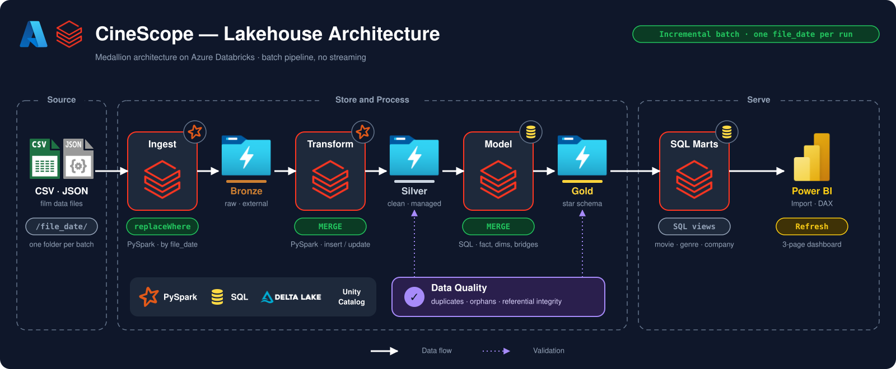
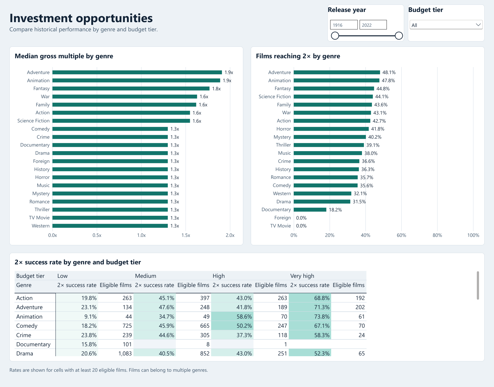
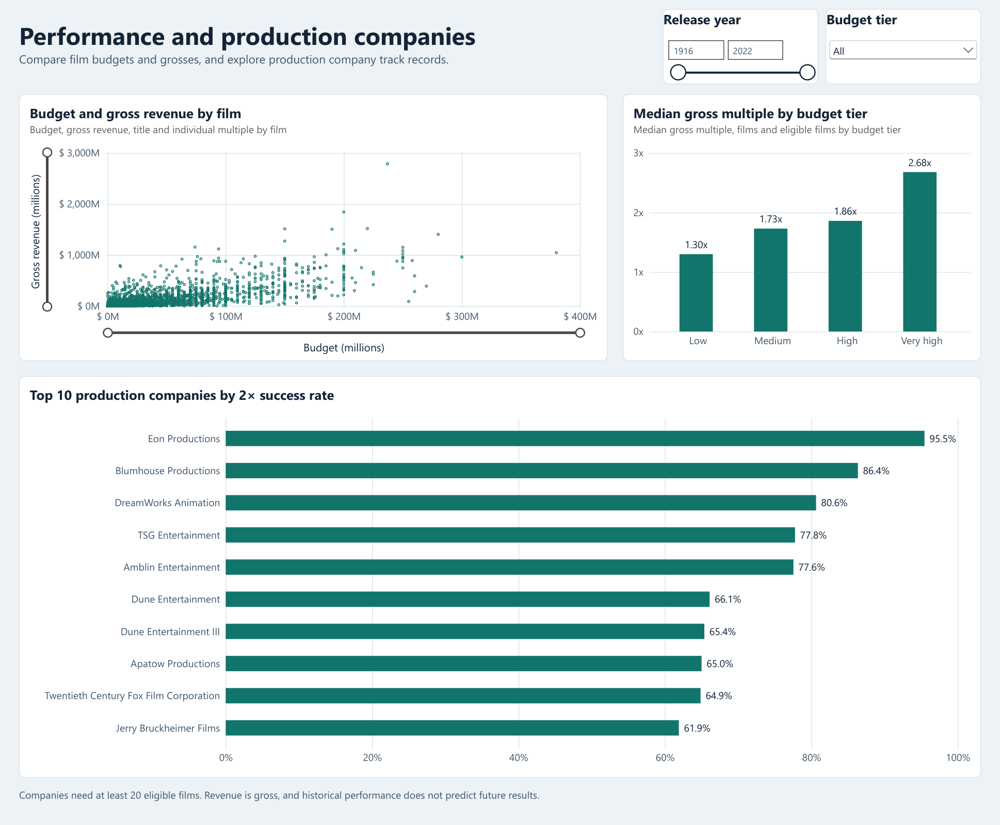

# CineScope — Movie Analytics Lakehouse

CineScope turns historical film data into a decision tool for production companies. It compares performance by **genre, production budget, production company, and release period** to help teams shortlist projects, set budget ceilings, and identify potential co-production partners.

The project follows the full data path from date-batched CSV and JSON files in **Azure Data Lake Storage Gen2** to a **Power BI** dashboard. The lakehouse uses **Azure Databricks, PySpark, SQL, Delta Lake, and Unity Catalog**. Power BI uses **Power Query and DAX**, with editable project definitions versioned alongside the notebooks in **Git and GitHub**.

[Dashboard](#power-bi-dashboard) · [Architecture](#architecture) · [Setup](#configuration-and-execution)

## Results at a glance

| Measure | Validated snapshot |
| --- | ---: |
| Films analyzed | **4,725** |
| Valid film–genre associations | **11,935** |
| Valid film–production-company associations | **13,468** |
| Eligible films grossing at least 2× their production budget | **37.1%** |
| Median gross-to-budget multiple | **1.30×** |
| Gold bridges passing duplicate and orphan checks | **5 of 5** |

Dashboard metrics reflect the unfiltered snapshot. The 2× rate considers films with positive budget and gross revenue. Estimating producer profit also requires distribution splits, marketing, and other costs.

## Architecture

Solid arrows show batch data flow and dotted arrows show validation checks. Editable source: [draw.io file](docs/architecture/cinescope-architecture.drawio) · [PNG export](docs/architecture/cinescope-architecture.png)

Each run processes one `file_date` batch. The layers update incrementally, so earlier batches stay in place.

| Layer | Update pattern |
| --- | --- |
| Bronze | `replaceWhere` replaces only the `file_date` slice being loaded |
| Silver | Delta `MERGE` inserts new records and updates existing ones |
| Gold warehouse | Delta `MERGE` on the fact table, the film, person, and production company dimensions, and all five bridges. Small catalog dimensions are rebuilt |
| SQL data marts | Views over Gold, with no physical load |
| Power BI | Refresh reloads the imported model |

- **Bronze** — Twelve loaders read the batch selected by the `file_date` widget. They write external Delta tables with the batch date and use `replaceWhere` to replace that slice on reruns.
- **Silver** — PySpark casts and standardizes fields and adds ingestion metadata. Delta `MERGE` uses entity or association keys to update existing records and insert new ones.
- **Gold** — The warehouse builds `fact_movies` at film grain, eight dimensions, and five bridges for cast, genre, language, production company, and production country. The annual `dim_time` supplies the release decade.

Three independent SQL views expose the warehouse at the grain each analysis needs.

| View | Grain | Analysis |
| --- | --- | --- |
| `mart_movie_performance` | One row per film | Portfolio KPIs, budget tiers, release decades, and film-level comparisons |
| `mart_genre_performance` | One row per film–genre pair | Genre rankings and genre-by-budget analysis |
| `mart_company_performance` | One row per film–company pair | Production company track records |

## Engineering decisions

- **Batch date as an explicit processing boundary.** Notebook runners pass `file_date` to their child notebooks. Bronze can replace one slice, while Silver merges that slice into consolidated tables.
- **Referential integrity at the warehouse boundary.** The [validation notebook](data_quality/validate_data.ipynb) recorded 225 film–genre rows in Silver with no matching film. The [genre bridge](gold/data_warehouse/bridges/bridge_movie_genres.ipynb) joins associations to Gold dimensions before merging. The quality notebook fails when any of the five Gold bridges contains duplicate keys or references missing a film or dimension record.
- **Metrics at the right grain.** A film can belong to multiple genres and production companies. Portfolio KPIs come from the film mart. The genre and company views supply their own analyses, with one-way relationships from the film table so that both shared filters reach all three marts.
- **Import mode for interactive analysis.** Power Query loads the three Databricks views and DAX aggregates the imported metrics. Users can explore the report using the local imported model between refreshes.

## Power BI dashboard

**Editable projects** · [English PBIP](powerbi/en/movie-analytics-dashboard.pbip) · [Spanish PBIP](powerbi/es/movie-analytics-dashboard.pbip)

The report has three pages and seven charts. The release-year interval and budget tier are synchronized across all pages. The screenshots show the English edition with the full period selected. The [Spanish edition screenshots](docs/images/es/) are also available.

### Overview and trends

The 2× success rate was **31.7% in the 2000s** and **38.0% in the 2010s**, across 2,009 and 1,417 eligible films. The 1950s reached 92.3% across 26 films. Cohort sizes help producers choose relevant comparison periods and judge how much weight to give an unusually high rate.

### Investment opportunities

Adventure reached 2× in **48.1% of 773 films** and **71.3% of 202 films** in the very-high-budget tier. At a medium budget, Horror provides a different comparison at **58.5% across 195 films**. The matrix requires at least 20 eligible films per cell, giving producers a way to shortlist projects within the budget they can actually fund.

### Performance and production companies

The median multiple ranges from **1.30× for low-budget films** to **2.68× for very-high-budget films**. The scatter plot illustrates why a producer still needs downside scenarios. *Avatar* and *The Lone Ranger* had budgets of $237 million and $255 million, but grossed about $2.79 billion and $89 million, respectively.

The company ranking helps screen potential partners. **Eon Productions** reached 2× in 21 of 22 eligible films, while **Twentieth Century Fox Film Corporation** reached it in 64.9% of 222 films. Comparing rates and sample sizes provides a starting point for due diligence before committing capital or sharing it with a co-producer.

## Configuration and execution

### Databricks

1. Import the notebook directories into an Azure Databricks workspace or clone the repository into a Databricks Git folder. Keep the directory layout intact for the relative `%run` and `dbutils.notebook.run` calls.
2. Use Unity Catalog-enabled compute with access to the `databricks_ws` catalog. Configure permissions to read the source ADLS location, write the Bronze external Delta location, and create schemas, tables, and views. For a different catalog, adapt the qualified names in your workspace copy.
3. Set the source and Bronze paths in [includes/configuration.ipynb](includes/configuration.ipynb). Place the source files under `<source_folder_path>/<file_date>/`. The Azure resources and input files must be supplied separately.
4. Run the three notebooks in [schemas/](schemas/). Then run the sequence below, using the same `file_date` in all three batch runners. Repeat for each available batch.

   | Step | Notebook |
   | --- | --- |
   | Load source files | [Bronze runner](bronze/00.run_all_loads.ipynb) |
   | Clean and merge the batch | [Silver runner](silver/00.run_all_ingestions.ipynb) |
   | Build the warehouse | [Gold warehouse runner](gold/data_warehouse/00.run_all_data_warehouse.ipynb) |
   | Validate Silver and Gold | [Data quality notebook](data_quality/validate_data.ipynb) |
   | Create the reporting views | [Financial mart notebooks](gold/data_marts/financial/) |

The loaders expect `movie.csv`, `language.csv`, `genre.csv`, `country.json`, `person.json`, `movie_genre.json`, `movie_cast.json`, and `language_role.json`. They also read CSV files in `production_company/` and `movie_company/`, and JSON files in `movie_language/` and `production_country/`.

### Power BI Desktop

1. Clone or download the repository. Keep the `.pbip`, `.Report`, and `.SemanticModel` items together in the chosen language folder.
2. Replace the server hostname and SQL Warehouse HTTP path placeholders in the three `Databricks.Catalogs` calls under that project's `.SemanticModel/definition/tables/`.
3. Open the `.pbip` in Power BI Desktop, authenticate to Databricks, select **Refresh**, and save to persist the imported data locally.

Git contains the editable report and model definitions. The local Import cache and machine-specific settings are excluded. The screenshots let you review the dashboard without a SQL Warehouse.

## Repository layout

| Path | Contents |
| --- | --- |
| [`bronze/`](bronze/) and [`silver/`](silver/) | Date-parameterized source loads and Delta ingestion |
| [`gold/data_warehouse/`](gold/data_warehouse/) | Fact table, dimensions, bridges, and warehouse runner |
| [`gold/data_marts/financial/`](gold/data_marts/financial/) | Three independent reporting views |
| [`data_quality/`](data_quality/) | Duplicate and referential-integrity checks |
| [`includes/`](includes/) and [`schemas/`](schemas/) | Shared notebook configuration and schema setup |
| [`powerbi/`](powerbi/) | English and Spanish editable Power BI projects |
| [`docs/architecture/`](docs/architecture/) | Architecture diagram in draw.io, SVG, and PNG formats |
| [`docs/images/`](docs/images/) | Power BI screenshots in [English](docs/images/en/) and [Spanish](docs/images/es/) |
